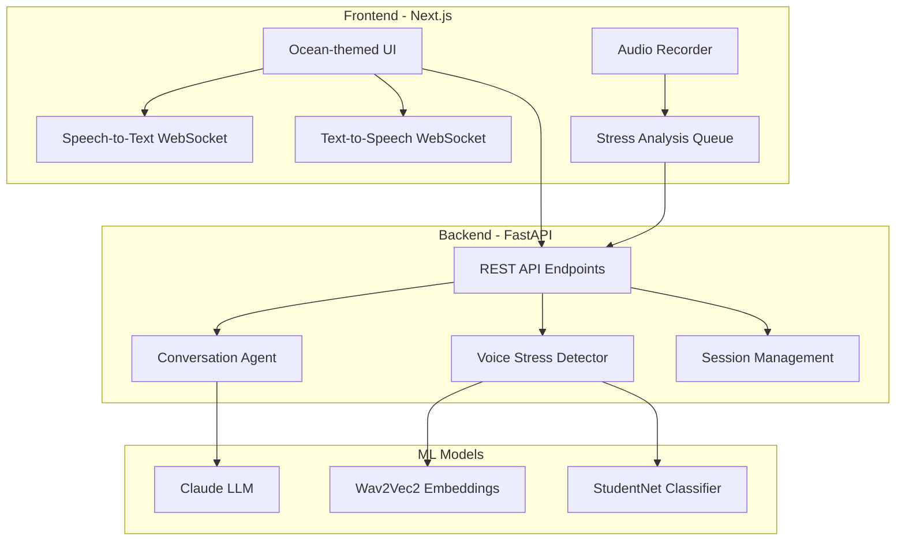

# 🌊 Mindful - AI-Powered Stress Detection & Assessment

An empathetic AI companion that combines **voice stress analysis** with **conversational AI** to provide comprehensive mental wellness insights. Built with Next.js, FastAPI, and deep learning models.

   

## ✨ Features

### 🎤 Voice Stress Analysis
- **Real-time speech-to-text** with voice stress detection
- **Deep learning model** (StudentNet + Wav2Vec2 embeddings) for analyzing vocal patterns
- **Continuous audio processing** with queue-based analysis to prevent data loss
- Audio debugging and cross-checking capabilities

### 💬 Conversational AI Assessment
- **LangGraph-powered** agentic conversation flow
- Structured stress assessment questionnaire
- **LLM-based analysis** with Anthropic Claude integration
- Natural, empathetic dialogue for user comfort

### 📊 Comprehensive Reporting
- **Ensemble scoring** combining voice (40%) and text (60%) analysis
- Visual stress progression tracking across questions
- Detailed insights with key indicators, positive factors, and recommendations
- Calming ocean-themed UI designed to reduce user anxiety

### 🎨 Beautiful UI/UX
- **Ocean-inspired design** with soothing teals, blues, and coral accents
- Animated floating blobs and gentle wave patterns
- Glassmorphism effects and smooth transitions
- Responsive design for desktop and mobile

## 🏗️ Architecture



## 🚀 Getting Started

### Prerequisites

- **Python 3.8+**
- **Node.js 18+** and npm
- **FFmpeg** (for audio processing)

### Backend Setup

1. **Navigate to backend directory**
   ```bash
   cd backend
   ```

2. **Create virtual environment**
   ```bash
   python3 -m venv venv
   source venv/bin/activate  # On Windows: venv\Scripts\activate
   ```

3. **Install dependencies**
   ```bash
   pip install -r requirements.txt
   ```

4. **Set up environment variables**
   Create a `.env` file in the `backend` directory:
   ```env
   ANTHROPIC_API_KEY=your_anthropic_api_key_here
   ```

5. **Run the server**
   ```bash
   python3 server.py
   ```
   The backend will start on `http://localhost:8000`

### Frontend Setup

1. **Navigate to frontend directory**
   ```bash
   cd frontend
   ```

2. **Install dependencies**
   ```bash
   npm install
   ```

3. **Set up environment variables**
   Create a `.env.local` file:
   ```env
   NEXT_PUBLIC_AGENT_URL=http://localhost:8000
   NEXT_PUBLIC_STT_URL=ws://localhost:9000
   NEXT_PUBLIC_TTS_URL=ws://localhost:9001
   ```

4. **Run the development server**
   ```bash
   npm run dev
   ```
   The frontend will start on `http://localhost:3000`

### External Services

You'll also need to run separate services for STT and TTS:
- **Speech-to-Text**: WebSocket server on port 9000
- **Text-to-Speech**: WebSocket server on port 9001

## 📁 Project Structure

```
is_project/
├── backend/
│   ├── server.py              # FastAPI main server
│   ├── src/
│   │   ├── stress_detector.py # Voice stress analysis
│   │   ├── embedding_extractor.py # Wav2Vec2 feature extraction
│   │   └── graph.py           # LangGraph conversation flow
│   ├── models/                # Pre-trained ML models
│   ├── debug_audio/           # Saved audio files for debugging
│   └── requirements.txt
├── frontend/
│   ├── app/
│   │   ├── page.tsx           # Main chat interface
│   │   ├── results/           # Results page
│   │   ├── components/        # Decorative UI components
│   │   ├── hooks/             # React hooks
│   │   └── globals.css        # Ocean theme styles
│   ├── audio/                 # Audio recording & processing
│   └── package.json
└── stress/                    # Original stress detection model
```

## 🎯 How It Works

### 1. User Flow
1. User starts assessment and receives greeting
2. AI asks 5 stress-related questions
3. User responds via voice or text
4. Voice is transcribed via STT and analyzed for stress
5. After all questions, comprehensive report is generated
6. Results displayed with visualizations and recommendations

### 2. Voice Stress Detection
- Audio recorded at 16kHz sample rate
- Converted to WAV format
- Processed through Wav2Vec2 for embeddings
- StudentNet classifier predicts stress level (0-1 scale)
- Results queued and stored per question

### 3. Ensemble Analysis
- **Voice Analysis (40%)**: Average stress from vocal patterns
- **Text Analysis (60%)**: LLM analysis of conversation content
- Combined into final stress score with confidence level
- Key indicators extracted from both sources

## 🔧 Key Technologies

**Frontend:**
- Next.js 15 (React 19)
- TypeScript
- Tailwind CSS
- WebSocket (STT/TTS)
- Web Audio API

**Backend:**
- FastAPI
- LangGraph (Agentic AI)
- PyTorch
- Wav2Vec2 (Hugging Face Transformers)
- Anthropic Claude API

**ML Models:**
- `audeering/wav2vec2-large-robust-12-ft-emotion-msp-dim` - Feature extraction
- Custom StudentNet classifier - Stress classification
- Claude 3.5 Sonnet - Conversational AI and text analysis

## 📊 API Endpoints

### Session Management
- `POST /api/session/start` - Create new assessment session
- `POST /api/message` - Send/receive conversation messages
- `GET /api/health` - Health check

### Stress Analysis
- `POST /api/analyze-stress` - Submit voice audio for analysis
- `GET /api/session/{id}/stress-report` - Get voice stress readings
- `GET /api/session/{id}/comprehensive-report` - Get full ensemble report

## 🎨 Design Philosophy

The UI follows a calming **ocean theme** to create a stress-free assessment experience:

- **Colors**: Deep ocean blues, soft teals, gentle corals
- **Animations**: Floating blobs, wave patterns, breathing effects
- **Typography**: Quicksand (body), Comfortaa (headings)
- **Interactions**: Smooth transitions, gentle feedback

## 🐛 Debugging

Audio files are automatically saved to `backend/debug_audio/` with metadata:
```
audio_YYYYMMDD_HHMMSS_microseconds.wav
```

Logs show audio properties at each stage:
- Frontend: WAV creation details
- Backend: Sample rate, duration, channels, RMS, max amplitude

## 🤝 Contributing

Contributions welcome! Please:
1. Fork the repository
2. Create a feature branch
3. Commit changes with clear messages
4. Submit a pull request

## 📝 License

MIT License - See LICENSE file for details

## 🙏 Acknowledgments

- Wav2Vec2 model by Facebook AI
- StudentNet architecture for efficient inference
- Anthropic Claude for conversational AI
- LangGraph framework for agentic workflows

## 📧 Contact

For questions or feedback, please open an issue on GitHub.

---

**Built with ❤️ for mental wellness**

